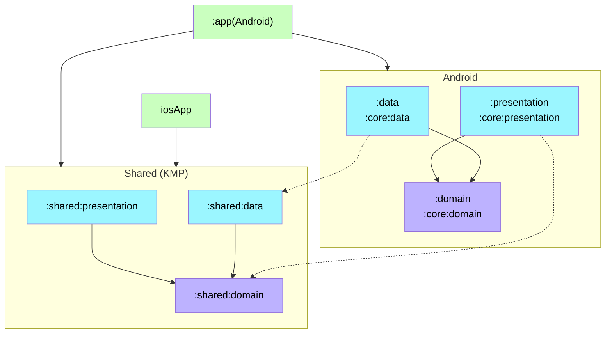

<h1 align="center">Turnin (턴인)</h1>

## About

'나'에게 집중하고 '나'를 구성하고 있는 키워드들을 작성해보세요.

'나'와 유사한 키워드를 가진 또 다른 사람을 만나볼 수 있어요.

이제 타인으로 향한 시선 대신 '나'의 시선으로 전환해봐요.

### Demo

## Features

| 분류      | 기능                                         |
|---------|--------------------------------------------|
| 계정      | 소셜 로그인 / 회원가입, 로그아웃 / 탈퇴, 계정 정보 수정         |
| 키워드     | 키워드 등록 / 조회 / 수정 / 삭제, 홈 피드, 유사 키워드 사용자 탐색 |
| 친구      | 친구 목록, 친구 요청 / 거절 / 요청 취소                  |
| 신고 / 차단 | 프로필 신고 / 차단, 키워드 신고, 차단 사용자 목록             |
| 알림      | 푸시 알림, 알림 목록, 공지사항                         |

## Tech Stack

| 구분            | 사용 기술                                          |
|---------------|------------------------------------------------|
| Language      | Kotlin, Coroutines & Flow                      |
| UI            | Jetpack Compose, Navigation Compose            |
| DI            | Hilt, Koin (Shared)                            |
| Network       | Retrofit, OkHttp, Ktor (Shared)                |
| Local         | Room, DataStore                                |
| Multiplatform | Kotlin Multiplatform (Android / iOS)           |
| Firebase      | Auth, FCM, Analytics, Crashlytics, Performance |
| Test          | JUnit, MockK, Mokkery                          |
| Build         | Version Catalog, Convention Plugins, ktlint    |
| CI / CD       | GitHub Actions, Firebase App Distribution      |

- Android: minSdk 26 / targetSdk 36

## Architecture

Clean Architecture를 따르며, 의존 방향은 `data → domain ← presentation`입니다.
계층 경계는 모듈 의존성으로 강제하고, UI는 단방향 데이터 흐름(`Event → State → UI`)으로 상태를 관리합니다.

- 실선은 계층 간 의존, 점선은 Android가 공유 기능을 사용하는 의존입니다.
- domain 계층은 다른 계층에 의존하지 않습니다.
- `:core:designsystem`, `:core:common`과 `:shared` 조립 모듈은 생략했습니다.

| 모듈                                    | 역할                                            |
|---------------------------------------|-----------------------------------------------|
| `:app`                                | 앱 진입점, Hilt 구성, 공유 모듈(Koin)과 Hilt 연결          |
| `:presentation` / `:domain` / `:data` | Android 기능 모듈. 기능별 패키지(home, friend, ...)로 구성 |
| `:core:*`                             | 공통 UI, 도메인, 데이터, 디자인 시스템                      |
| `:shared:*`                           | Android와 iOS가 함께 쓰는 기능 (KMP)                  |
| `iosApp`                              | 공유 모듈을 사용하는 iOS 앱                             |

Android 네이티브 구조를 유지하면서, iOS와 함께 쓰는 기능만 하나씩 `:shared`로 옮깁니다.
자세한 내용은 [KMP 마이그레이션 전략](docs/spec/kmp-migration-strategy-v2.md)을 참고하세요.

## Build & Test

### Build Types

| 빌드 타입         | 설명                                            |
|---------------|-----------------------------------------------|
| `debug`       | 개발/로컬 서버, 디버그 서명                              |
| `release`     | 운영 서버, 릴리즈 서명                                 |
| `releaseTest` | release 설정 + 디버그 서명, 개발/로컬 서버 (릴리즈 빌드 동작 확인용) |

### 테스트 실행

| 범위              | 명령                                                                                                                |
|-----------------|-------------------------------------------------------------------------------------------------------------------|
| 전체              | `./gradlew testDebugUnitTest`                                                                                     |
| Android 모듈      | `./gradlew testDebugUnitTest -x testAndroidHostTest -x test`                                                      |
| Shared (KMP) 모듈 | `./gradlew testAndroidHostTest`                                                                                   |
| JVM 모듈          | `./gradlew :domain:test :core:domain:test`                                                                        |
| iOS (macOS)     | `./gradlew :shared:domain:iosSimulatorArm64Test :shared:data:iosSimulatorArm64Test :shared:iosSimulatorArm64Test` |
| 특정 테스트          | `./gradlew :모듈:태스크 --tests "패턴"`                                                                                  |

- 모듈 종류마다 테스트 태스크 이름이 다릅니다: Android `testDebugUnitTest`, JVM `test`, KMP `testAndroidHostTest`.
- JVM/KMP 모듈에도 `testDebugUnitTest` 별칭이 등록되어 있어, 전체 실행 한 번으로 모든 단위 테스트가 실행됩니다.
- 특정 테스트는 실제 태스크 이름을 사용합니다.  (예:
  `./gradlew :shared:data:testAndroidHostTest --tests "*AnnouncementRepository*"`)
- `./gradlew test`는 Android 모듈의 모든 빌드 타입 테스트까지 실행하므로 권장하지 않습니다.

## CI / CD

`main` 대상 PR마다 ktlint, 단위 테스트, 빌드를 자동으로 검증하고,
`main`에 병합되면 Firebase App Distribution과 Google Play 비공개 테스트 트랙에 자동 배포합니다.

## Getting Started

개발 환경 설정, 브랜치/커밋 규칙은 [CONTRIBUTING.md](CONTRIBUTING.md)를 참고하세요.

## Documents

| 문서                                                      | 내용                   |
|---------------------------------------------------------|----------------------|
| [CONTRIBUTING.md](CONTRIBUTING.md)                      | 개발 환경, 빌드/테스트, 작업 규칙 |
| [ERROR_STRATEGY.md](ERROR_STRATEGY.md)                  | 에러 처리 전략             |
| [KMP 마이그레이션 전략](docs/spec/kmp-migration-strategy-v2.md) | 공유 모듈 구조와 기능 이동 절차   |
| [docs/decisions](docs/decisions)                        | 의사 결정 기록             |
| [docs/notes](docs/notes)                                | 기술 노트                |
